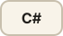
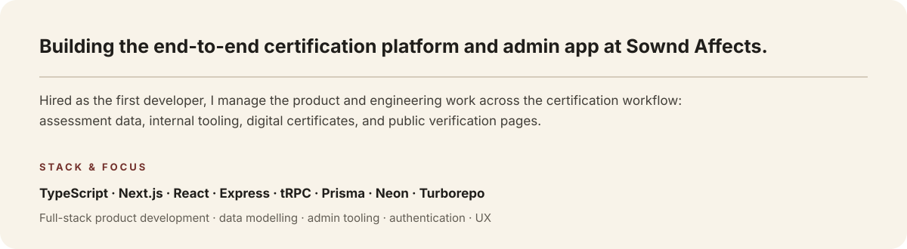
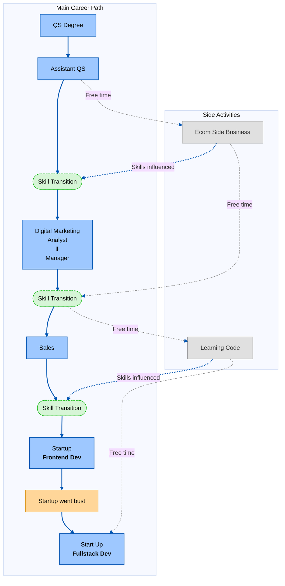

<p align="center">
  <a href="https://lordmarshy.github.io/" target="_blank" rel="noopener noreferrer"></a>
</p>

# Guy - Full-Stack Product Engineer

<p align="center">
  <a href="https://lordmarshy.wombus.com/" target="_blank" rel="noopener noreferrer"></a>
  <a href="https://www.linkedin.com/in/guymarshman" target="_blank" rel="noopener noreferrer"></a>
</p>


---

## 🛠️ Core Toolkit

### Interface engineering

<p>
  
  
  
  
</p>

### Systems, data & deployment

<p>
  
  
  
  
  
  
  
</p>

### Product design practice

Currently developing my product-design practice.

<p>
  
  
  
</p>

### Interactive development

<p>
  
  
  
</p>

---

## ⚡ Projects & Work

<h3>Commercial Work</h3>
<section>
  <p><strong>Sownd Affects - Full-Stack Product Engineer</strong></p>

  <p>
    
  </p>
</section>

<section>
  <h4>iRealty - Junior Front-End Developer</strong></h4>
  <p>
    Worked on a PropTech startup, improving the customer-facing experience across mobile and tablet. Built shared customer-support tooling, property filtering and comparison features, and multilingual support in Catalan and French.

  <p><strong>Stack &amp; focus:</strong> Node.js · JavaScript · React · Redux · CSS · Sass · Tailwind CSS. Responsive UI, CRM features, customer-support tooling, and localisation.</p>
</section>

**Hand Coded Projects**

- **[Mood_Tracker_CLI](https://github.com/wobwobbird/Mood_Tracker)**  
  Mental Health Tracker CLI tool, record mood and review results. Uses Ink to create a full screen TUI, saves results in a SQLite database.  
  [](https://skillicons.dev)  
  `Also used: Ink`  
 
- **[Tap 'O' Matic](https://github.com/wobwobbird/Tap-O-Matic)**  
  A React Native TypeScript random number generator app.  
  README includes Expo Go QR code, scan then view in the Expo Go app  
  [](https://skillicons.dev)  
  `Also used: React Native | Expo`  
    
- **[Super Connect](https://github.com/wobwobbird/Super-Connect-Game)**  
  A two-player turn-based Connect 4–style game built in Unity 6 (URP). Get four in a row: horizontally, vertically, or diagonally to win. Full game with start scene, player naming, scoring, winning screen, music control, 3D background and animations.  
  [](https://skillicons.dev)

**AI Assisted Projects**
- **[Git Proof](https://github.com/wobwobbird/gitproof)**  
  Issue **developer proofs** for a GitHub username: attach projects (repo URL, optional live link, verified/revoked status, checklist flags), store them in **Neon** (serverless Postgres) via Prisma, and share a read-only public **`/proof/[id]`** page. Admin UI under **`/admin`**; frosted shell, App Router, server actions.  
  [](https://skillicons.dev)  
  `Also used: Neon`

- **[Time_Blocks](https://github.com/wobwobbird/Time_Blocks)**  
  Time Blocks Logger is a small time-tracking app: log time by category (e.g. Coding, Learning, Game Dev), see daily and weekly totals, and enforce a 24-hour-per-day limit so you can’t over-log a single day.  
  [](https://skillicons.dev)  
  `Also used: React Admin | Supabase`

**Learning Projects**
- **[Ravenous_Restaurant_Search_API_App](https://github.com/wobwobbird/Ravenous_Restaurant_Search_API_App)**  
  A React web app that searches for restaurants using the Yelp API  
  This was a project for the 'skill path Create a Front-End App with React' on Codecademy.com  
  [](https://skillicons.dev)  

---

## 📝 Currently Learning

```yaml
- Bun
- Turborepo
- Next.js (App Router)
- Express
- tRPC
- Better Auth
- Prisma
- Neon
- AI Chatbots
- Docker
```

---

<details>
  <summary><strong>Career Flow Chart</strong></summary>
  
  **Hello World!**
  


</details>


