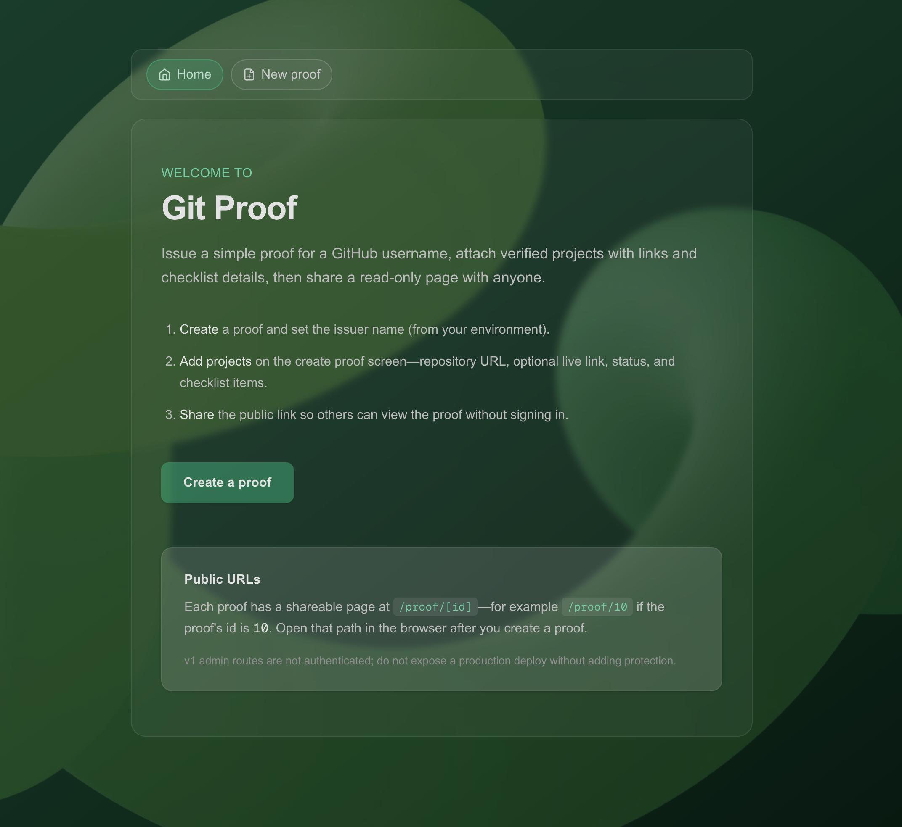
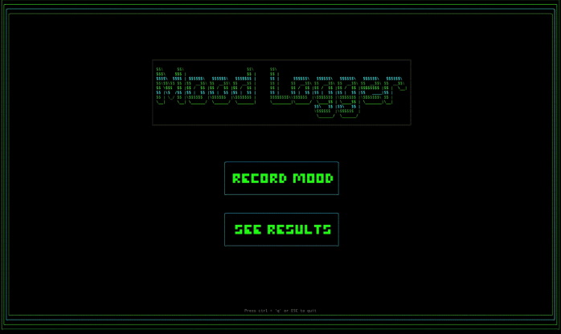
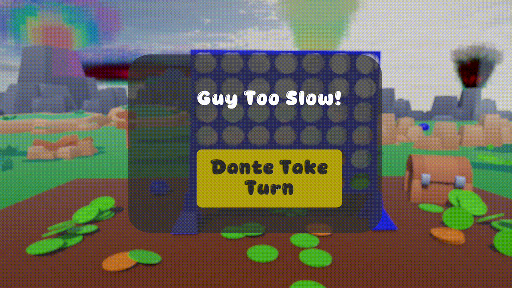

# Hi, I'm Guy

### Full-stack product engineer building useful, thoughtful products.

Based in London · Mostly backend, always end-to-end · [LinkedIn](https://www.linkedin.com/in/guymarshman)

---

| Frontend | Backend | Product design |
| :--- | :--- | :--- |
| I build responsive, accessible interfaces that feel clear and dependable across devices. | I design and build the systems behind the product: APIs, authentication, data, and integrations. | I turn real user problems into focused, considered product experiences—from early ideas to production. |

## Selected work

<table>
  <tr>
    <td width="48%" valign="top">
      
    </td>
    <td width="52%" valign="top">
      <h3><a href="https://github.com/wobwobbird/gitproof">Git Proof</a></h3>
      
Developer-proof platform for attaching and verifying projects, then publishing a shareable read-only proof page.

      
<code>Next.js</code> · <code>TypeScript</code> · <code>Prisma</code> · <code>Neon</code>

    </td>
  </tr>
  <tr>
    <td width="52%" valign="top">
      <h3><a href="https://github.com/wobwobbird/Mood_Tracker">Mood Tracker</a></h3>
      
A terminal-based mood tracker for logging how you feel and reviewing your history from the command line.

      
<code>Node.js</code> · <code>SQLite</code> · <code>Ink</code>

    </td>
    <td width="48%" valign="top">
      
    </td>
  </tr>
  <tr>
    <td width="48%" valign="top">
      
    </td>
    <td width="52%" valign="top">
      <h3><a href="https://github.com/wobwobbird/Super-Connect-Game">Super Connect</a></h3>
      
A two-player Connect Four-style game with player setup, scoring, animations, music controls, and a 3D world.

      
<code>C#</code> · <code>Unity</code>

    </td>
  </tr>
</table>

### [Time Blocks](https://github.com/wobwobbird/Time_Blocks)

A time-tracking app for logging work by category, reviewing daily and weekly totals, and keeping every day within 24 hours.

`Next.js` · `Prisma` · `PostgreSQL` · `Supabase`

---

## Commercial work

### iRealty Front-End

Junior Front-End Developer at a PropTech startup. I made the customer-facing CRM responsive for tablet and mobile, and built property filtering, comparison, multilingual support, and a customer-support panel used across the app.

`JavaScript` · `React` · `Redux` · `Sass` · `Tailwind CSS`

### Sownd Affects

Full-Stack Product Developer on an internal certification platform for acoustic project workflows. I work across certificate ingestion, structured data, React admin tools, QR codes, public verification pages, authentication, and product features.

`React` · `Node.js` · `PostgreSQL` · `Authentication`

---

## Now

Currently deepening my knowledge of **Bun**, **Turborepo**, **Next.js App Router**, **tRPC**, **Better Auth**, **Prisma**, **Neon**, **AI chatbots**, and **Docker**.

_Always happy to connect about thoughtful products, useful tools, and interesting problems._

